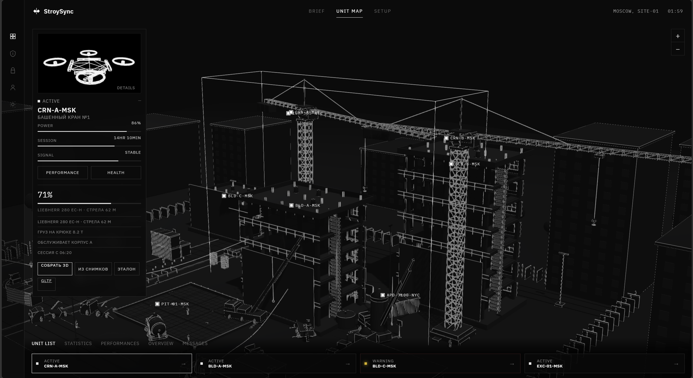
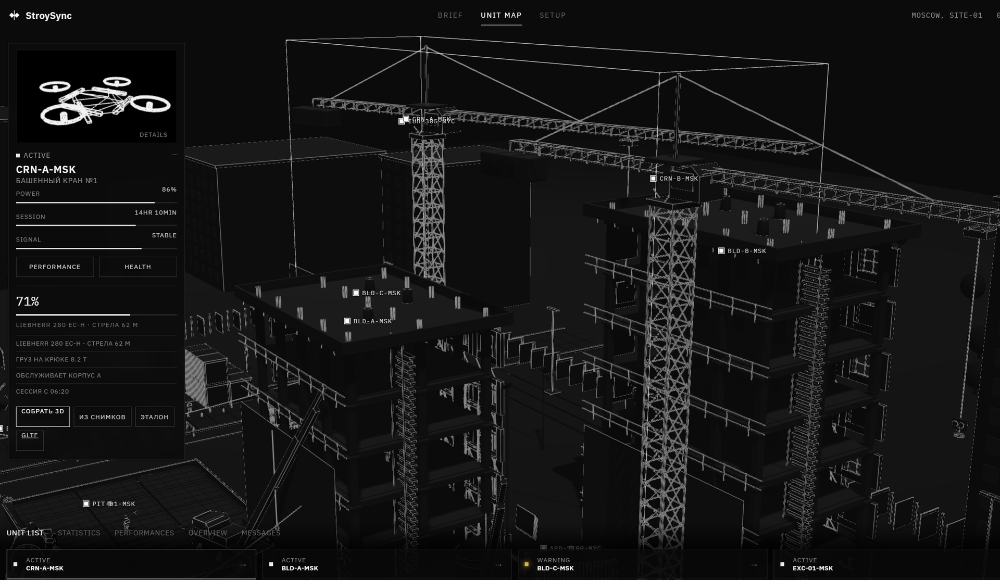
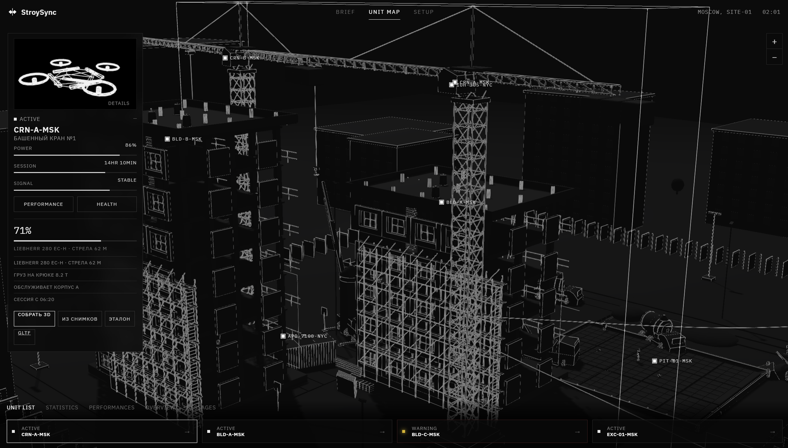

# StroySync

StroySync связывает кадр с камеры стройплощадки с календарным графиком (WBS) и картой участка. Детектор находит технику на снимке, матчер сравнивает состав машин с допустимым набором активного этапа и выдаёт статус: в графике, отклонение или критично.

## Pipeline

```text
снимок → детектор техники → сравнение с typical_signature / WBS → статус + правило
```

Бэкенды детектора: `auto` (world → coco → demo), `world` (YOLO-World), `coco` (YOLOv8n), `demo` (детерминированные боксы для тестов, не модель). По умолчанию — `auto`. Для офлайн CI задайте `DETECTOR_BACKEND=demo`.

YOLO-путь сохраняется: при доступном Ultralytics поднимается YOLO-World (или COCO), иначе система откатывается на demo.

## Запуск

Основной способ — Docker Compose:

```powershell
docker compose up --build
```

- UI: http://localhost:8080
- API / дашборд: http://localhost:8000
- OpenAPI: http://localhost:8000/docs

Скопируйте `.env.example` в `.env` при необходимости. `CORS_ORIGINS` — список origin через запятую (не `*`).

Локально без Docker (Windows): `start-backend.bat` и `start-frontend.bat` поднимают FastAPI и Vite; bat-файлы явно ставят `DETECTOR_BACKEND=demo` для работы без весов.

```powershell
# backend вручную
python -m venv .venv
.\.venv\Scripts\Activate.ps1
pip install -r backend\requirements.txt
$env:PYTHONPATH = "$pwd\backend"
$env:DETECTOR_BACKEND = "demo"
uvicorn app.main:app --app-dir backend --reload --port 8000

# frontend
cd frontend
npm install
npm run dev
```

Тесты (offline, demo):

```powershell
cd backend
$env:DETECTOR_BACKEND = "demo"
pytest -q
```

CLI:

```powershell
$env:PYTHONPATH = "$pwd\backend"
python -m app.cli analyze data\samples\sample_foundation.jpg --camera CAM-01 --at 2026-09-17T10:15:00
```

## Стек

- Backend: FastAPI, SQLAlchemy (SQLite / PostgreSQL), OpenCV, Pillow; опционально Ultralytics (YOLO-World / YOLOv8)
- Frontend: React + Vite; встроенный дашборд на `backend/app/static`
- Данные: CSV/XLSX график, markdown-хранилище Obsidian (`HACAOBS/`)
- Поставка: Docker Compose

Шейдеры участка (triplanar / Unreal / Unity) лежат в `tools/site_dcc/shaders/` и используются пайплайном сборки сцены.

## Структура

```text
backend/app/      API, детектор, матчер WBS, дашборд
frontend/         React UI
data/schedule/    календарный график
data/samples/     сэмплы кадров
HACAOBS/          заметки площадки (markdown)
tools/site_dcc/   сборка сцены и шейдеры
docs/             DATA_MODEL.md, скриншоты
```

## Карта участка

Трёхмерная площадка SITE-01 (корпуса, краны, котлован). Выбор объекта открывает карточку статуса.







## Limitations

- Модель не дообучалась на закрытой разметке площадки; open-vocabulary YOLO-World / COCO дают грубые классы техники.
- `demo` не распознаёт произвольные фото — только стабильные боксы по имени сцены для pytest и офлайн-прогона.
- Сопоставление с графиком — по пересечению множеств кодов техники и правилам WBS, без трекинга по видеоряду.
- Сгенерированные twin-файлы (`media/twins/*.bin`, `*.ply`) в репозиторий не входят; сцена собирается при работе сервиса.

Подробнее о сущностях: `docs/DATA_MODEL.md`.
